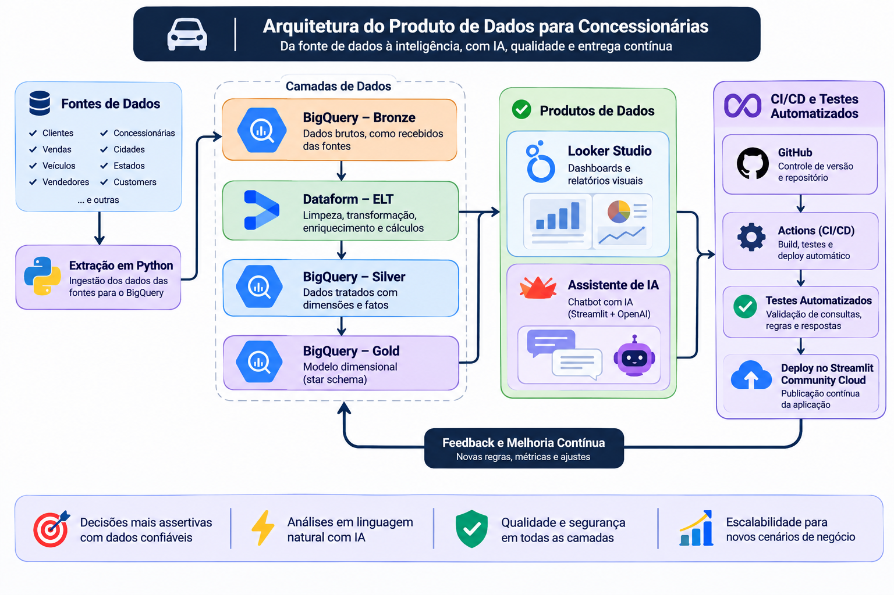

# AI Analytics Assistant — Concessionárias

MVP de assistente analítico em Streamlit, com OpenAI Responses API, Function Calling e consultas somente leitura à camada Gold do BigQuery.

## Status

- Fase 1 concluída: fonte de dados analisada e documentada.
- Fase 2 concluída: conexão com BigQuery, consultas parametrizadas, validação de acesso e smoke test com dados reais.
- Fase 3 concluída: camada semântica em YAML, carregador com validação e testes das regras oficiais.
- Fase 4 implementada: Responses API, Function Calling e 5 ferramentas controladas.
- Fase 5 implementada: interface Streamlit, 4 páginas, cards, gráficos Plotly, tabelas e histórico.
- Rastreamento de qualidade implementado: eventos de busca, notas do usuário e análise de repetição no BigQuery.
- Próxima: Fase 6 — GitHub, Secrets e deploy no Streamlit Community Cloud.

## Produto de dados para Concessionárias

Pipeline ELT no ecossistema Google Cloud que transforma dados brutos de vendas de uma rede de concessionárias em um modelo estrela na camada gold, alimentando 5 dashboards estratégicos no Looker Studio.


---

## Arquitetura: Medalhão (Bronze → Silver → Gold)

```

┌────────────────────────────────────────────────────────────────────┐
│                       FONTES DE DADOS                               │
│                                                                    │
│  Clientes, vendas, veículos, vendedores, concessionárias,          │
│  cidades, estados, customers e outras fontes.                      │
└──────────────────────────────┬─────────────────────────────────────┘
                               │
                               ▼
┌────────────────────────────────────────────────────────────────────┐
│                       EXTRAÇÃO EM PYTHON                            │
│                                                                    │
│  Scripts Python responsáveis pela ingestão dos dados das fontes   │
│  e carregamento no Google BigQuery.                                │
└──────────────────────────────┬─────────────────────────────────────┘
                               │
                               ▼
┌────────────────────────────────────────────────────────────────────┐
│                          BRONZE (Raw)                               │
│                                                                    │
│  8 tabelas brutas:                                                 │
│  clientes, vendas, veiculos, vendedores,                            │
│  concessionarias, cidades, estados, customers                      │
│                                                                    │
│  Dados como ingeridos, preservando a estrutura original,           │
│  sem tratamento ou transformação analítica.                       │
└──────────────────────────────┬─────────────────────────────────────┘
                               │
                               ▼
              ┌────────────────────────────────┐
              │          DATAFORM — ELT        │
              │                                │
              │  Limpeza, casts, JOINs,        │
              │  enriquecimento e cálculos.    │
              └────────────────┬───────────────┘
                               │
                               ▼
┌────────────────────────────────────────────────────────────────────┐
│                       SILVER (Tratado)                              │
│                                                                    │
│  5 dimensões:                                                      │
│  dim_clientes, dim_veiculos, dim_vendedores,                       │
│  dim_concessionarias, dim_calendario                               │
│                                                                    │
│  2 fatos:                                                          │
│  fato_vendas (limpa), fato_vendas_enriquecida (wide)               │
│                                                                    │
│  Métricas calculadas:                                              │
│  desconto, faixa_preco, categoria_desconto, ticket, percentuais.   │
└──────────────────────────────┬─────────────────────────────────────┘
                               │
                               ▼
              ┌────────────────────────────────┐
              │          DATAFORM — ELT        │
              │                                │
              │  Renomeação, padronização,     │
              │  organização e estruturação   │
              │  do modelo dimensional.        │
              └────────────────┬───────────────┘
                               │
                               ▼
┌────────────────────────────────────────────────────────────────────┐
│                    GOLD (Modelo Estrela)                            │
│                                                                    │
│                    ┌──────────┐                                    │
│                    │dim_tempo │                                    │
│                    └────┬─────┘                                    │
│                         │                                          │
│   ┌───────────┐         │         ┌───────────┐                    │
│   │dim_cliente│─────────┤─────────│dim_veiculo│                    │
│   └───────────┘         │         └───────────┘                    │
│                         │                                          │
│                    ┌────┴─────┐                                    │
│                    │fato_vendas│                                   │
│                    └────┬─────┘                                    │
│                         │                                          │
│   ┌────────────┐        │        ┌──────────────────┐              │
│   │dim_vendedor│────────┤────────│dim_concessionaria│              │
│   └────────────┘        │        └──────────────────┘              │
│                                                                    │
│  ┌──────────────────────────────────────────────────────────────┐  │
│  │ vw_fato_completa (VIEW)                                      │  │
│  │ Consulta única com os JOINs entre fatos e dimensões,         │  │
│  │ preparada para consumo analítico.                            │  │
│  └──────────────────────────────────────────────────────────────┘  │
└──────────────────────────────┬─────────────────────────────────────┘
                               │
                  ┌────────────┴────────────┐
                  │                         │
                  ▼                         ▼
┌──────────────────────────────┐  ┌──────────────────────────────────┐
│       PRODUTO DE DADOS 1     │  │         PRODUTO DE DADOS 2       │
│                              │  │                                  │
│       LOOKER STUDIO          │  │       ASSISTENTE DE IA           │
│                              │  │       STREAMLIT                  │
│  5 dashboards                │  │                                  │
│  Cross-filtering             │  │  Chatbot analítico conectado     │
│  Indicadores estratégicos    │  │  aos dados reais do BigQuery.    │
│  Relatórios visuais          │  │                                  │
│  Análise de performance      │  │  ┌────────────────────────────┐  │
│                              │  │  │        OPENAI API          │  │
│                              │  │  │ Interpretação de perguntas │  │
│                              │  │  │ e geração de insights.     │  │
│                              │  │  └─────────────┬──────────────┘  │
│                              │  │                │                 │
│                              │  │                ▼                 │
│                              │  │  ┌────────────────────────────┐  │
│                              │  │  │       FUNCTION CALLING     │  │
│                              │  │  │ Acionamento de ferramentas │  │
│                              │  │  │ analíticas controladas.    │  │
│                              │  │  └─────────────┬──────────────┘  │
│                              │  │                │                 │
│                              │  │                ▼                 │
│                              │  │  ┌────────────────────────────┐  │
│                              │  │  │      CAMADA SEMÂNTICA      │  │
│                              │  │  │ Métricas, dimensões, regras│  │
│                              │  │  │ de negócio e contexto.     │  │
│                              │  │  └─────────────┬──────────────┘  │
│                              │  │                │                 │
│                              │  │                ▼                 │
│                              │  │  ┌────────────────────────────┐  │
│                              │  │  │       BIGQUERY — GOLD      │  │
│                              │  │  │ Consultas aos dados        │  │
│                              │  │  │ analíticos autorizados.    │  │
│                              │  │  └────────────────────────────┘  │
└──────────────────────────────┘  └──────────────────────────────────┘
                  │                         │
                  └────────────┬────────────┘
                               │
                               ▼
┌────────────────────────────────────────────────────────────────────┐
│                  CI/CD E TESTES AUTOMATIZADOS                       │
│                                                                    │
│  ┌──────────────────────────────────────────────────────────────┐  │
│  │ GITHUB                                                       │  │
│  │ Versionamento e controle do código-fonte.                   │  │
│  └──────────────────────────────┬───────────────────────────────┘  │
│                                 │                                  │
│                                 ▼                                  │
│  ┌──────────────────────────────────────────────────────────────┐  │
│  │ GITHUB ACTIONS (CI/CD)                                       │  │
│  │ Build, integração, execução de testes e automação do deploy. │  │
│  └──────────────────────────────┬───────────────────────────────┘  │
│                                 │                                  │
│                                 ▼                                  │
│  ┌──────────────────────────────────────────────────────────────┐  │
│  │ TESTES AUTOMATIZADOS                                         │  │
│  │ Validação de consultas, transformações, métricas, regras     │  │
│  │ de negócio e respostas da aplicação.                        │  │
│  └──────────────────────────────┬───────────────────────────────┘  │
│                                 │                                  │
│                                 ▼                                  │
│  ┌──────────────────────────────────────────────────────────────┐  │
│  │ DEPLOY — STREAMLIT COMMUNITY CLOUD                           │  │
│  │ Publicação e atualização contínua da aplicação de IA.        │  │
│  └──────────────────────────────────────────────────────────────┘  │
└──────────────────────────────┬─────────────────────────────────────┘
                               │
                               ▼
┌────────────────────────────────────────────────────────────────────┐
│                  FEEDBACK E MELHORIA CONTÍNUA                       │
│                                                                    │
│  Novas regras de negócio, métricas, ajustes nas transformações,   │
│  correções e melhorias identificadas nos produtos de dados.       │
│                                                                    │
│  Retroalimentação da ELT para evolução da qualidade dos dados,    │
│  dos modelos analíticos e dos produtos disponibilizados.          │
└──────────────────────────────┬─────────────────────────────────────┘
                               │
                               └──────────────► DATAFORM — ELT
                                                (novo ciclo)
```


## Configuração

Localmente, aponte a credencial da conta de serviço. No Streamlit Cloud, não use caminho de arquivo; use `GOOGLE_APPLICATION_CREDENTIALS_JSON` nos Secrets com o conteúdo integral do JSON:

```bash
export GOOGLE_APPLICATION_CREDENTIALS="caminho/para/service-account.json"
export GCP_PROJECT_ID="projeto-dev-410722"
export GCP_DATASET="gold_clau"
export GCP_LOCATION="US"
export OPENAI_API_KEY="sua-chave-rotacionada"
export OPENAI_MODEL="gpt-6-luna"
```

Em produção, copie `.streamlit/secrets.toml.example` para `.streamlit/secrets.toml` e preencha `GOOGLE_APPLICATION_CREDENTIALS_JSON`. Nunca commite credenciais.

## Testes

```bash
.venv/Scripts/python -m pytest -q
```

## Smoke test de consultas reais

```bash
.venv/Scripts/python scripts/smoke_test_bigquery.py
```

O smoke test valida conexão, objetos Gold, contagem de vendas, faturamento por ano, perfil de desconto e unicidade das chaves de dimensão.

## Smoke test da OpenAI

```bash
.venv/Scripts/python scripts/smoke_test_openai.py
```

## Rastreamento de qualidade

O Chat IA salva eventos de busca e notas de satisfatória, dúvidas ou resultado errado no BigQuery. A view `analytics_ops.vw_chat_interactions` traz uma linha por evento com a última nota já achatada, facilitando consultas no Console. A página **Qualidade** mostra buscas repetidas e problemas por assunto. Detalhes em `docs/qualidade_rastreamento.md`.

Antes do primeiro uso, crie o dataset `analytics_ops` com uma credencial que tenha permissão de criação:

```bash
.venv/Scripts/python scripts/setup_feedback_tables.py
```

A conta de serviço da aplicação precisa de `bigquery.dataEditor` somente nesse dataset; a conta atual não tem permissão para criar datasets.

## Executar a interface

```bash
.venv/Scripts/python -m streamlit run streamlit_app.py
```

Sempre use o Python do `.venv`: o Python global pode não ter `google-cloud-bigquery` instalado.

## Deploy no Streamlit Community Cloud

1. Faça commit e push deste diretório para o repositório `https://github.com/DevVitorSantos/Ia_Produto_dados_concessionarias.git`.
2. No Streamlit Community Cloud, crie um app apontando para o repositório, branch `main` e arquivo principal `streamlit_app.py`.
3. Em **Advanced settings**, use Python 3.12 e cole o conteúdo de `.streamlit/secrets.toml` no campo **Secrets**.
4. Nos Secrets de produção, use uma chave OpenAI rotacionada e o JSON completo da conta de serviço em `GOOGLE_APPLICATION_CREDENTIALS_JSON`.
5. A conta de serviço precisa de acesso de leitura ao dataset `gold_clau` e `bigquery.dataEditor` no dataset `analytics_ops`.
6. Valide no app publicado: Home, Chat IA com gráfico, registro de feedback e página Qualidade.

Nunca commite `.streamlit/secrets.toml`, JSON de credencial, `.venv` ou artefatos locais.

